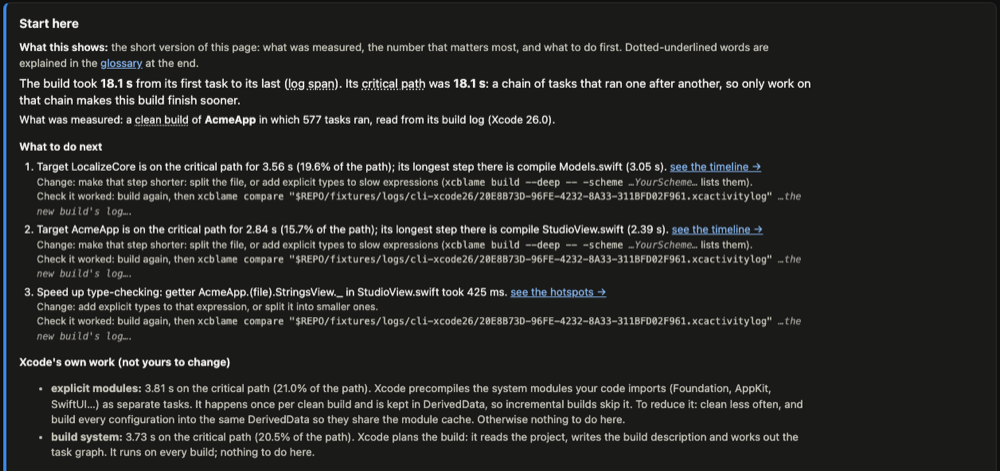
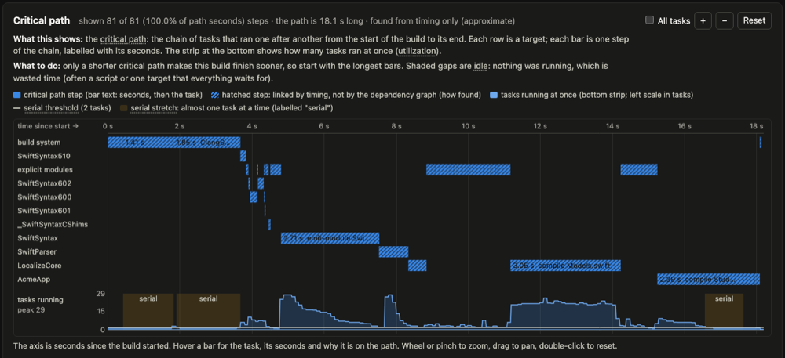

# xcblame

**Find out why your Xcode build is slow, and fix it safely.**

<br clear="left">

[](https://github.com/iasaeed/xcblame/releases)
[](https://github.com/iasaeed/xcblame/actions/workflows/ci.yml)


[](https://github.com/iasaeed/homebrew-tap)
[](LICENSE)

<p align="center">
  
</p>

xcblame is a command-line tool for macOS. It reads your Xcode build log and tells you, in plain words, where the
time went and what to change first. It can then test a change for you and keep it only if the build really got faster.
It is one Swift binary. Nothing leaves your machine.

Status: 0.6.0, macOS 14+, Xcode 26+.

## Why is my Xcode build slow?

When you press ⌘B, Xcode does several kinds of work:

- **Planning.** Xcode reads the project and works out which tasks to run, and in which order.
- **Compiling Swift files.** Each file is parsed, type-checked and turned into machine code.
- **Building modules.** Every target and package becomes a module. Xcode also precompiles the system modules you
  import (Foundation, SwiftUI, …).
- **Linking.** The compiled pieces are joined into one app binary.
- **Code signing.** The app is signed so the device or simulator accepts it.
- **Scripts.** Your "Run Script" build phases run (linters, code generators, uploads).

Many of these tasks run at the same time, on several CPU cores ("lanes"). The build ends when the longest chain of
tasks that wait on each other ends. That chain is the **critical path**. Making a task faster only helps if it sits
on that chain.

Common causes, and what xcblame looks for:

| Cause | What you see | The fix | Rule |
|---|---|---|---|
| Whole-module compilation in Debug | Every small edit recompiles the whole module | Debug Compilation Mode: Incremental (`singlefile`) | SET-001 |
| Building every architecture in Debug | Each file compiles twice (arm64 and x86_64) | Debug "Build Active Architecture Only" = Yes | SET-005 |
| dSYM files in Debug | A `GenerateDSYMFile` task on every build | Debug Debug Information Format = DWARF | SET-004 |
| Optimizer on in Debug | Compiles are slow for no benefit while debugging | Debug Optimization Level = `-Onone` | SET-002 |
| Script phases without declared outputs | "Run Script" runs on every build, even when nothing changed | List the script's Input Files and Output Files | PHASE-001 |
| Linters and uploads in every build | SwiftLint or a symbol upload adds seconds to each build | Run them on Release, in CI or before commit | PHASE-002, PHASE-003 |
| A long critical path, too few busy lanes | Most cores sit idle while one target compiles | Split the target everyone waits for | GRAPH-005, DYN-001 |
| Type-check-heavy expressions | One file takes seconds; a big SwiftUI `body` | Add explicit types, split the expression or the view | SRC-001, SRC-006 |
| Dependency fan-in | One change in a core module rebuilds most of the app | Keep widely imported modules small and stable | GRAPH-004 |
| Cache misses | Clean builds after a branch switch redo everything | Compilation caching (Xcode 26+), measured first | SET-016, CI-001 |

**Clean or incremental?** A *clean* build starts from nothing (after Product › Clean Build Folder, or on a fresh CI
machine). An *incremental* build reuses the work of the previous build and only redoes what your edit touched. Most
of your day is incremental builds, so a slow incremental build costs you the most. The two kinds have different causes,
so only compare builds of the same kind. xcblame labels every build as clean, incremental, zero-change (nothing was
edited) or cached.

`xcblame rules explain <ID>` explains any rule in the table. The full catalog is in [docs/RULES.md](docs/RULES.md).

## How xcblame helps

- **It measures.** `xcblame build` runs `xcodebuild` for you, or `xcblame analyze` reads a build log you already have
  (an `.xcactivitylog`, an `.xcresult`, or a DerivedData folder).
- **It explains.** It finds the critical path, splits the time by target and by file, lists the slowest expressions to
  type-check, and says why each task re-ran in an incremental build. Xcode's own work (planning, system modules) is
  shown separately, so you don't blame your code for it.
- **It fixes.** It ranks the changes worth making. `xcblame verify` builds your project several times without and
  with a change, and keeps the change only if it is faster beyond normal noise. Kept changes go into an xcconfig
  overlay file that you can revert at any time. Your `.xcodeproj` file is never edited.
- **It works the same in CI.** A committed baseline turns any CI build into a regression check.

The HTML report opens with a "Start here" box: what was measured, the number that matters, and what to do next.

<p align="center">
  
</p>

## Get started in 5 minutes

1. **Install** with Homebrew.

   ```sh
   brew tap iasaeed/tap
   brew install xcblame
   ```

   `xcblame --version` should print `0.6.0`. The tap is
   [iasaeed/homebrew-tap](https://github.com/iasaeed/homebrew-tap). It installs a prebuilt universal binary (arm64 and
   x86_64). From source: `swift build -c release`.

2. **Build your app once in Xcode** (Product › Build, or ⌘B). Xcode writes a build log to DerivedData, and xcblame
   reads that log.

3. **Open the report.** In Terminal, inside your project folder:

   ```sh
   xcblame analyze --format html --open
   ```

   Your browser opens a report of the latest build. It is saved in `.xcblame/reports/`.

4. **Read the "Start here" box** at the top. It names the build kind, the critical path, and up to three next steps,
   each with how to check that it worked.

5. **Audit your settings** without building:

   ```sh
   xcblame doctor
   ```

   You get a list of findings, each with a rule ID such as `SET-005`. `xcblame rules explain SET-005` tells you what
   the rule means.

6. **Test one fix.** Commit your work first: verify needs a clean git tree so it can restore files exactly.

   ```sh
   xcblame fix --rules SET-005                      # prints the plan; nothing changes
   xcblame fix --install-hook                       # once per project, if the plan's HOOK section asks for it
   xcblame verify --rules SET-005 --kind clean -- -scheme AcmeApp
   ```

   Verify builds without and with the change (5 builds each by default). The verdict is `kept`, or `reverted` with a
   reason such as `slower` or `within noise`. Replace `AcmeApp` with your scheme.

7. **Apply what was kept.**

   ```sh
   xcblame fix --rules SET-005 --apply
   ```

   This writes `.xcblame/overlay-Debug.xcconfig`. Commit it so your team gets the same speed-up.
   `xcblame fix --revert` undoes it, byte for byte.

8. **Check the result.** Build again in Xcode, run `xcblame analyze`, then compare the two builds:

   ```sh
   xcblame history list                             # every analyzed build gets an id
   xcblame compare <before-id> <after-id>
   ```

   You see the change in total time, critical path, targets and settings.

## Everyday commands

| Want to… | Run |
|---|---|
| See the report for the last Xcode build | `xcblame analyze --format html --open` |
| Build and report in one go | `xcblame build --html -- -scheme AcmeApp` |
| Pick an older build log | `xcblame analyze path/to/Logs/Build --list`, then `--index <n>` |
| Check project settings without building | `xcblame doctor AcmeApp.xcodeproj` |
| Understand why a small change rebuilt so much | `xcblame why -- -scheme AcmeApp` |
| Find the slowest functions to type-check | `xcblame build --deep -- -scheme AcmeApp` |
| Compare two builds | `xcblame compare before.json after.json` (reports, logs or history ids) |
| See how build time changes over days | `xcblame trend --kind incremental --by branch` |
| Read what a finding means | `xcblame rules explain SET-001` |
| Print a fix plan | `xcblame fix` |
| Verify a fix | `xcblame verify --rules SET-004 --kind clean -- -scheme AcmeApp` |
| Apply kept fixes | `xcblame fix --install-hook --apply` |
| Undo the newest applied plan | `xcblame fix --revert` |

Everything after `--` goes to `xcodebuild` unchanged. `xcblame build` returns xcodebuild's own exit code.
`xcblame help <command>` shows every flag.

## Use it in CI

```sh
# Save a baseline from recent good builds and commit it (.xcblame/baseline.json)
xcblame baseline save --kind clean --last 5

# Fail the job if the build is more than 10 % slower than the baseline (exit 3)
xcblame build --format github --baseline .xcblame/baseline.json --fail-if-slower 10 -- -scheme AcmeApp

# Build with the kept fixes from the overlay, without touching the project (needs -configuration)
xcblame build --overlay -- -scheme AcmeApp -configuration Debug
```

`--format github` adds a summary to the job page (`$GITHUB_STEP_SUMMARY`) and `::warning`/`::error` annotations for
build errors, warnings, type-check hotspots and a regression.

`--format` takes `text`, `json`, `html`, `markdown`, `github`, `junit` or `agent`. `-o <file>` writes the report to a
file and keeps a one-line summary on stdout.

| Format | Use |
|---|---|
| `json` | The full report (`xcblame.report/1`); default when stdout is not a terminal and `CI=true`. |
| `markdown` | A PR comment (65 KB cap). |
| `github` | Markdown for `$GITHUB_STEP_SUMMARY`, plus annotations. |
| `junit` | JUnit XML: validation, regression and the budgets of `.xcblame/config.json` as test cases. |
| `agent` | A compact summary for coding agents (8 KB cap). |

```sh
xcblame analyze --format junit -o build-time.xml
xcblame schema --document all                         # JSON Schema (draft 2020-12) of every document
```

**Redaction.** `--redact` replaces your home folder, user name, host name, repo path and DerivedData hash with tokens.
It is on by default for `html`, `markdown`, `github` and `agent`, because those reports leave the machine. It works
for every format. If a report cannot be redacted, nothing is written and xcblame exits 1.

## Reading the report

- **Build kind**: clean, incremental, zero-change or cached. Only compare builds of the same kind.
- **Critical path**: the chain of tasks that set the total time. Shortening anything off this chain does not make the
  build finish sooner.
- **Xcode's own work**: planning and system modules. Shown separately, with what (if anything) you can do about it.
- **Fix plan**: concrete changes in a safe order. Each names the Xcode setting and the measured or estimated saving.
- **Glossary**: every term in the report is explained at the bottom of the page.

The critical-path timeline shows one row per target. Each bar is one step of the chain. The strip at the bottom shows
how many tasks ran at once; "serial" marks stretches where almost nothing ran in parallel.

<p align="center">
  
</p>

## Exit codes

| Code | Meaning |
|---|---|
| 0 | Success. |
| 1 | Internal error, a failed self-validation check (the numbers it guards are withheld), or a report that could not be written safely. |
| 2 | Usage error. |
| 3 | `--fail-if-slower` or `compare --threshold` exceeded. |
| 4 | `doctor --fail-on <severity>`: a finding at or above that severity. |
| 5 | Log, result bundle or project not found or not readable. |
| 6 | `verify` aborted (dirty tree, battery, another build, thermal, timeout, broken baseline build, interrupted); finished verdicts are kept. |

`xcblame build` exits with xcodebuild's code by default (`--exit-code xcblame` for the table above; 124 on
`--timeout`).

## What xcblame writes

- **`.xcblame/`** in the current folder: `history/`, `snapshots/`, `reports/`, `plans/`, `backup/`, `cache/` and
  friends. Its own `.gitignore` keeps it out of git. Only `baseline.json`, the `overlay-<Configuration>.xcconfig`
  files that `fix --apply` writes, and the optional `config.json` are meant to be committed. `--xcblame-dir` moves it.
- **`~/Library/Caches/xcblame`**: the build-settings cache. `xcblame history prune --oracle-cache` clears it.
- **Your project, only when you ask.** `fix --install-hook` appends one `#include?` line to each configuration's base
  xcconfig (the bytes are backed up; `--uninstall-hook` restores them). `fix --apply-defaults` writes Xcode `defaults`
  (prior values saved; `--revert` restores them). `verify` writes only temporary overlay blocks and restores them
  after each build. Everything else only reads project files and logs.

## Roadmap

v0.6 shipped `fix` and `verify`: apply findings as an xcconfig overlay through a one-line hook or a `-xcconfig`
wrapper, A/B verify the saving, and auto-revert what is not faster. v0.7 is next: `--edit-project` (pbxproj, scheme
and manifest edits).

## Docs

- [docs/DESIGN.md](docs/DESIGN.md): command surface, architecture, data formats, algorithms, roadmap.
- [docs/RULES.md](docs/RULES.md): the rule catalog (detection, fix, apply policy, evidence).
- [docs/SCHEMA-v0.4.md](docs/SCHEMA-v0.4.md): the report, compare, trend and baseline documents.
- [docs/SCHEMA-v0.6.md](docs/SCHEMA-v0.6.md): the fix plan and verify documents, the overlay file and the hook.
- [fixtures/ANONYMIZATION.md](fixtures/ANONYMIZATION.md): how the test fixtures were made synthetic or anonymised.
- [docs/assets/README.md](docs/assets/README.md): how the images on this page are made.

## Contributing

Issues and pull requests are welcome at https://github.com/iasaeed/xcblame. Run `swift test` before sending a change.
The fixtures are synthetic or anonymised; read [fixtures/ANONYMIZATION.md](fixtures/ANONYMIZATION.md) before adding
any.

## License

MIT, see [LICENSE](LICENSE).
